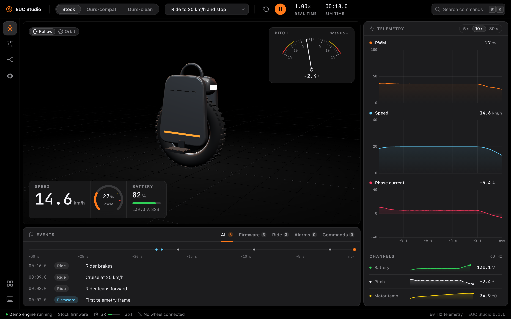

# EUC Studio

**Run real electric-unicycle firmware in a 3D simulation with a physical rider. Inspect it, compare it, improve it.**

EUC Studio is a workbench for people who want better and safer EUC controller firmware. It runs the controller's
actual firmware image on an emulated microcontroller. Motor, battery, wheel, and rigid rider models supply its inputs.
The simulator helps inspect behavior under specified conditions. It does not establish real riding safety.



<sub>The desktop Ride workspace runs real firmware on the project's CPU core, with motor, battery, terrain, and rider models.
Some physical parameters remain estimates. Desktop workflow completion is in progress.</sub>

> [!WARNING]
> Custom firmware can make a wheel cut out, injure its rider or destroy its power stage. Read [SAFETY.md](SAFETY.md)
> before you build, flash or ride anything from this repository.

## What it is for

- **See the firmware work.** Watch balance, motor control, tiltback and cutoffs react to a rider in 3D, with scopes,
  an event timeline and the firmware's own variables live.
- **Compare stock and custom firmware.** Run both on the same ride, side by side, and find the first moment they differ.
- **Change one thing at a time.** Our own firmware for the Begode Extreme reproduces the stock behavior, quirks
  included, and then fixes them one by one, each fix shown in a scenario.
- **Grow to other wheels.** Wheels, boards and processors are described as data, so new models and brands can follow.

## How it works

```
 firmware image ─▶ emulated MCU (ARMv7-M core + peripheral models)
                        │ PWM ▲ currents, halls, voltages, IMU
                        ▼     │
                   inverter ─▶ motor ─▶ battery          (electrical plant, 5 µs steps)
                        │ torque ▲ wheel speed
                        ▼        │
                   wheel, tire, shell, human rider       (MuJoCo, 0.5 ms steps)
                        │
                        ▼
          EUC Studio app · CLI `euc` · Python bindings
```

Everything runs on one deterministic clock counted in microcontroller cycles, so every run can be replayed exactly.
See [docs/architecture.md](docs/architecture.md).

The first wheel is the **Begode Extreme**. Its stock firmware boots unchanged in the Rust engine.
The simulator reproduces the observed interfaces. Unknown hardware values remain explicit estimates.

## Status

| Milestone | Implemented | Remaining |
|---|---|---|
| M0 Foundation | Repository, CI, vendor guard, fetch and image gates | Maintain these gates for new features |
| M1 Stock boots | Stock boots and sends telemetry on the Rust engine | Broader hardware calibration |
| M2 Stock rides in 3D | Live electrical/body physics, terrain, display, telemetry and Ride workspace | Measured battery, motor and suspension limits |
| M3 Own CPU core | Own ARMv7-M core and reference lockstep checks | Detailed flash timing; Tune memory writes, gain editing, and runtime quirks |
| M4 Human rider | Rigid and articulated rider control, fall release, scenarios, .eucrec recordings, Python bindings, generated-map free ride, and recorded map context | Independent foot contact, calibrated human response, exact audio playback, and broader physical validation |
| M5 Our firmware | Compat and clean run in the simulator, desktop, and CLI | Known cut-off edge cases; hardware validation |
| M6 Flasher | Image gate; separate simulation/sealing foundation patches | OTA protocol, complete safety gates and fault-recovery evidence |
| M7 Release | Desktop source builds, local package tooling, and wheel onboarding work | Final integrated package checks, public signing, docs site, browser firmware demo and a second wheel |
| M8 Bench | Safety procedure only | Authorized controlled bench work and trace comparison |

Details: [docs/roadmap.md](docs/roadmap.md).
The [request ledger](docs/project-status.md) identifies unfinished requests and current checks.

Desktop Tune reads live variables, scopes, triggers, and per-handler ISR estimates.
Compare runs bounded A/B scenarios and shows traces, events, and sampled body playback.
These implementations still need integrated runtime checks.
See [coverage](docs/models/coverage-matrix.md), [Python](docs/python.md), and [recordings](docs/recordings.md).
The [human and free ride plan](docs/models/human-and-free-ride.md) defines later work.

## Stock firmware is never in this repository

`euc fetch <wheel>` downloads the official image from the manufacturer's own update server to your machine and checks
it against the sha256 pins built into the tool. Nothing from the vendor image is stored here, and a
[guard](tools/vendor-guard/README.md) blocks it on every commit.

## Try it

You need Rust (the version is pinned in `rust-toolchain.toml`), Python 3.11+, and for the other parts the tools
listed in each area's README.

```sh
git config core.hooksPath tools/hooks             # once per clone: the vendor guard runs before each commit
python3 tools/fetch-mujoco/fetch.py                # once per clone: the pinned MuJoCo library the physics links

cargo run -p euc-cli -- fetch begode-extreme       # download and verify the official Begode Extreme build
cargo run -p euc-cli -- firmware list
cargo run -p euc-cli -- image validate <file>      # the image gate the flasher will use
cargo run -p euc-cli -- flash --sim --synthetic    # the gated flasher against the simulated wheel (no real flash)

# run stock firmware with the project's CPU core
cargo run --release -p euc-cli -- sim run begode-extreme --seconds 10 --inject V@2.6
# ride it: motor, battery, body and rider simulated, expectations checked (scenarios/)
cargo run --release -p euc-cli -- sim run --scenario scenarios/ride-20kmh-stop.toml

(cd firmware && cmake --workflow --preset target-clean)  # our firmware image (Arm GNU Toolchain)
(cd app && pnpm install && pnpm tauri dev)                # the EUC Studio app (Node, pnpm, Tauri)
```

## Repository

| Path | What |
|---|---|
| [`crates/`](crates) | Rust engine, firmware sources, image tools, CLI `euc` |
| [`firmware/`](firmware) | our controller firmware in C11 |
| [`app/`](app) | the EUC Studio desktop app (Tauri, React) and its design system |
| [`profiles/`](profiles) | wheel definitions |
| [`docs/`](docs) | architecture, roadmap, specifications |
| [`tests/data/`](tests/data) | real-wheel captures used as test data |
| [`tools/`](tools) | vendor guard and git hooks |

## Contributing

See [CONTRIBUTING.md](CONTRIBUTING.md). In short: sign off your commits, never add vendor material, and back every
safety-relevant change with a scenario.

## License

EUC Studio is **source-available** under the [PolyForm Noncommercial License 1.0.0](LICENSE). You may use, study,
change and share it for any noncommercial purpose. Commercial use is not allowed. See [NOTICE](NOTICE) for
third-party components and trademarks.

EUC Studio is an independent project and is not affiliated with, endorsed by or sponsored by Begode or any other EUC
manufacturer.
