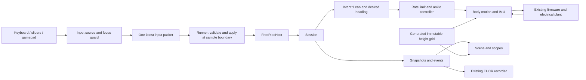
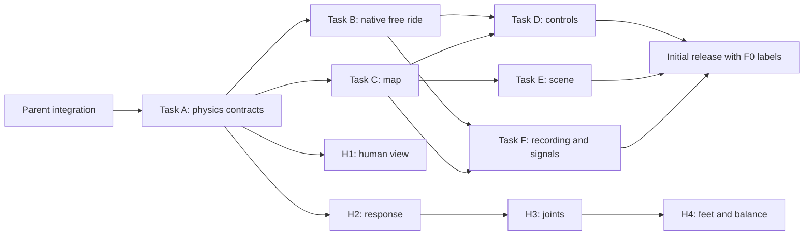

# Human model and free ride: design and implementation plan

> **Historical plan (2026-10-16).** Kept for its decisions and evidence. Free Ride has since become a play mode in
> the generated city, without arming, sliders, a rider choice or the map editor, and the opt-in lateral rider adds
> lateral leg joints. The current behavior is in the [Free Ride README](../../app/src/workspaces/freeRide/README.md),
> [Free Ride design](../design/free-ride.md), [body physics](body.md) and [project status](../project-status.md).

Status: implementation audit, 2026-10-16, completion worktree.
Update 2026-10-22: `articulated_sagittal_v1` is now the default rider for scenarios and the Ride workspace.
Independent foot contact (the first H4 step) is the opt-in model `articulated_contact_v1`; `articulated_sagittal_v1` keeps welded feet. Free Ride starts on `articulated_sagittal_v1` too. The rigid baseline stays selectable.
See [articulated acceptance](articulated-acceptance.md#default-rider-and-foot-contact-2026-10-22).
The text below is the 2026-10-16 audit.
The first physical `articulated_sagittal_v1` slice is implemented in `euc-physics`.
Actual cached stock FreeRide acceptance now passes for both models after the articulated task-torque mapping correction.
The articulated model remains experimental. Mechanical braking, mild grades, a small bump, and momentum-preserving release now pass focused tests. Native generated-terrain steering passes for both rider models over 14 driven seconds. These bounded checks do not establish measured rider behavior.
Sections describing later increments remain requirements, not completion claims.
See [the articulated implementation handoff](../superpowers/plans/2026-10-16-articulated-rider.md) for exact interfaces and regression evidence.

## 1. Scope and decisions

The user approved generated terrain with adjustable slopes, bumps, and potholes.
The user approved keyboard controls, on-screen sliders, and gamepad controls.
These requirements replace the earlier input and map assumptions.
The first increment uses the existing rigid rider and labels its aids.
Later increments improve the human model in separate steps.

The first increment provides a finite 3D map and direct desired body lean.
It also provides desired heading, play, pause, reset, telemetry, and recording.
It does not provide real elevation import or full skeletal physics.
Real elevation remains a later input adapter for the same map interface.
It requires separate source, license, resolution, and coordinate work.

The human worker owns the physical rider source and its focused tests.
The parent owns native model selection, recording context, and desktop controls.
Ampere owns the high-speed/SOC stress scenarios and `scenario.rs`.
Turing owns battery test work.
Physics regressions use no firmware image. Native acceptance reads verified stock firmware from the private local cache.
Neither path uses hardware, private body data, or production flashing. No vendor bytes enter public files.
It does not change the default rider mass, control gains, release thresholds, or aids.

## 2. What the code already does

Paths below start at the repository root.
Evidence describes the current working tree, not only the earlier planning baseline.

| Area | Current source | Implemented behavior | Remaining limit |
|---|---|---|---|
| Model selection | `crates/euc-physics/src/params.rs`, `RiderModel`, `Rider` | Rigid default; explicit articulated option in native Free Ride and the desktop selector | Broader motion acceptance remains open |
| Physical articulation | `mjcf.rs`, `articulated`, `limb` | Upper body plus left/right thighs, shanks, feet; six pitch hinges | No independent pelvis/trunk joint, lateral joints, or self collision |
| Body transport | `lib.rs`, `body_ids`, `bodies`, `poses` | Stable model-dependent body order and actual MuJoCo poses | Consumers must accept nine bodies for the new model |
| Lean control | `rider.rs`, `ankle_torque`; `lib.rs`, `step` | Existing delayed/slew-limited lean controller distributes its task moment through all six internal leg motors | Direct lean does not use speed-mode tiltback easing |
| Posture | `lib.rs`, `set_crouch`, `rider_joints` | Bounded knee request; internal hip/knee/ankle posture torques | Estimated gains and strength; no muscle or fatigue model |
| Steering and roll | `lib.rs`, `step` | Existing external shell aids and signed aid work remain explicit | No physical lateral rider balance or aid-free steering |
| Release | `lib.rs`, `leave`; `mjcf.rs`, pedal welds | Both articulated feet release with the complete rider tree; joint motors stop | Welded pedal support before release; no foot slip or gait |
| Delay | `params.rs`, `RiderControl`; `rider.rs`, `TickDelay` | Separate request/feedback delays, zero by default, bounded to 0.30 s | No measured reaction calibration; crouch request currently bypasses these queues |
| Free ride | `engine/free_ride.rs`, `FreeRideHost` | Play mode (2026-10-22): a 1.5 s stand boot, input live at once, a crash never pauses, respawn at the last clear spot or the start, wheel buttons and power off/on, no run limit with bounded native memory; stock acceptance passes | Integrated desktop interaction remains open |
| Recording | `crates/euc-sim/src/recording.rs`, `RecordingContext` | Optional typed context carries the actual model and authoritative map; rigid/articulated round trips pass | Historical board outputs and audio remain absent |
| Detailed human diagnostics | `lib.rs`, `RiderState`, `rider_joints` | Actual joint angles/rates/torques, upper-body lean, aid work | Joint signals are not yet appended to EUCT channels |

### High-impact limits found in this audit

- The rigid foot weld transmits support without friction or contact-load limits.
- The new model also uses named pedal welds; articulation does not provide validated foot contact.
- The rigid ankle proxy retains 2 kg on the shell after release.
  The new model removes that proxy and carries all selected rider mass in its released body tree.
- External roll and yaw aids can supply work without an internal reaction.
  Their signed work can hide positive/negative cancellation; it is not a complete actuator energy budget.
- Generic geometry, segment fractions, strength, gains, and delays are estimates.
  None are measured rider parameters.
- The former fixed three-body export blocked articulation.
  `body_ids` now supplies one stable order for both metadata and poses.
- The rigid tire exports 48 real capsule shapes.
  The audit found that a 32-shape per-body reader cap rejected that unchanged metadata.
  Parent replaced that cap with the existing total shape budget and added rigid/articulated capture regressions.
  The physics export retains all tire shapes.

### Important distinctions

The rider already has feet, leg, arm, torso, and head collision shapes.
Their masks allow contact with the ground and exclude the wheel and shell.
The masks exist before and after release.
Some source comments still say there are no rider collisions or only torso contact.
The generated MJCF is the stronger evidence here.

The rigid feet shapes do not provide friction contact with the pedals.
The `on_pedals` weld supplies attachment through the ankle hinge.
Rigid release leaves one main body with its existing motion. Articulated release preserves the seven-body tree.
It does not create an articulated fall or a walking recovery.
The 30 N·m, 0.2 s step-off kick is an existing artificial disturbance.

The yaw aid is a capped external torque on the shell.
It does not currently twist separate feet or legs.
The roll aid also acts directly on the shell.
They can do mechanical work without a matching human reaction torque.
A turn that uses these aids must carry an experimental model label.

`Intent::Lean` already uses the existing lean rate and torque limits.
It does not directly set wheel speed or motor torque.
Its branch does not use the speed controller's tiltback easing calculation.
Manual mode must show this difference.
Neutral lean does not mean zero speed or guaranteed braking.

## 3. Delivery increments

| Increment | User result                                              | Physical scope                                           | Dependency                                        |
| --------- | -------------------------------------------------------- | -------------------------------------------------------- | ------------------------------------------------- |
| F0        | See accurate rider and aid limits                        | Existing dynamics; better parameter checks and telemetry | Parent completes engine and recording integration |
| F1        | Control lean on a finite flat map with all input methods | Existing ankle model; configurable heading aid           | F0 and native input contract                      |
| F2        | Edit slopes, bumps, and potholes on a 2D map             | One shared height grid for physics and view              | F1 and map transport                              |
| H1        | See a clearer generic human with stable dimensions       | Rendering changes only                                   | F0; can proceed beside F1                         |
| H2        | Compare finite control response and reaction delay       | Bounded command and feedback delays                      | F0; evaluate before default changes               |
| H3        | Bend hips and knees in a controlled prototype            | Articulated sagittal legs and trunk; retained attachment | H2 and body export changes                        |
| H4        | Study foot load, slip, stance, and lateral balance       | Independent feet, pedal contact, lateral joints          | H3 and contact metrics                            |

F1 and F2 form the initial free ride release.
H3 and H4 do not block that release.
A better visual model does not imply better human dynamics.
Each human increment retains an explicit model identifier.
Existing scenario behavior remains available as `rigid_ankle_v1`.

## 4. First release architecture



### Run selection

Add a run specification separate from `EngineClient.kind`.
Keep live, demo, and playback as engine transport identities.
Use `run_mode = scenario | free_ride` for live simulation.
Playback exposes the recorded run mode and disables all manual control.
The browser demo must identify itself and reject native free ride requests.

Proposed native types belong in `app/src-tauri/src/engine/free_ride.rs`:

```rust
pub enum RunSpec {
    Scenario { id: String },
    FreeRide(FreeRideSpec),
}

pub struct FreeRideSpec {
    pub wheel: String,
    pub settings: String,
    pub map: GeneratedMapSpec,
    pub rider_model: String,
}

pub struct ManualInput {
    pub run_epoch: u32,
    pub seq: u32,
    pub source: InputSource,
    pub desired_lean_rad: f64,
    pub heading_rate_rad_s: f64,
    pub armed: bool,
}
```

Use strict serde enums for `InputSource` and `rider_model`.
Use the variants `keyboard_slider` and `gamepad` for `InputSource`.
Accept only `rigid_ankle_v1` in the first release.
Validate all values in Rust, even after frontend validation.
Do not add a filename, firmware address, force, or motor torque to `ManualInput`.

Add `engine_set_run(spec)` and `engine_rider_input(input)` Tauri commands.
Retain `engine_play`, `engine_step`, `engine_restart`, and `engine_set_rtf`.
Extend `HostFactory` to consume `RunSpec` through one parent integration change.
Do not encode free ride as a fake scenario ID.

### Host and session ownership

Add `FreeRideHost` beside `RideHost` in `host.rs`.
It owns a `Session`, board output watcher, manual state, and immutable map identity.
It calls `Session::step` and never calls `Ride::sample`.
It does not collect `Ride.samples` or `Ride.observed` for an unlimited session.
It does not run scenario judging or scripted pushes.

`ManualState` uses this proposed field contract:

| Field                                | Native type      | Meaning                                   |
| ------------------------------------ | ---------------- | ----------------------------------------- |
| `run_epoch`, `applied_seq`           | `u32`            | Active run and last applied input         |
| `applied_t_s`                        | `f64`            | Simulation time at input application      |
| `source`                             | `InputSource`    | Selected motion source                    |
| `desired_lean_rad`                   | `f64`            | Validated user request                    |
| `commanded_lean_rad`                 | `f64`            | Rate-limited controller target            |
| `measured_lean_rad`                  | `f64`            | Physical rider lean                       |
| `desired_heading_rad`, `heading_rad` | `f64`            | Integrated target and measured heading    |
| `heading_rate_rad_s`                 | `f64`            | Current validated turn request            |
| `armed`, `attached`, `held`          | `bool`           | Explicit control and mechanical states    |
| `input_age_ms`                       | `u32`            | Native receipt age, bounded by saturation |
| `pause_reason`                       | `Option<String>` | Focus, timeout, boundary, or user pause   |

The input packet carries heading rate, not an angle integrated by the frontend.
Only the native session clock integrates the heading target.
This rule keeps steering consistent across real-time factors.

Add these proposed host methods:

```rust
fn set_manual_input(&mut self, input: ManualInput) -> Result<(), String>;
fn manual_state(&self) -> Option<ManualState>;
```

Default implementations reject input or return `None`.
`RideHost` and `StillHost` keep those defaults.
`FreeRideHost` applies lean and heading only while the rider remains attached.
Keep BLE output and board output handling shared with `RideHost`.
Avoid a second electrical or firmware stepping loop.

Extend `Session` with these signatures:

```rust
pub fn set_heading_target(&mut self, rad: f64) -> Result<(), String>;
pub fn rider_state(&self) -> RiderState;
```

`RiderState` contains the physical and controller values used by `ManualState`.
`rider_state()` returns desired lean, lean command, measured lean, heading, and attachment state.
Implement these through the live physics model.
Keep `Session::set_intent(Intent::Lean(rad))` as the desired lean route.
Expose position and heading through read-only physics state methods.

### Boot, play, pause, and reset

**Play mode (2026-10-22) replaces the arming rules in this section and in section 5.** The owner
asked to test and play without clicks, so:

- The stand lets go 1.5 s after the build (`BOOT_S`). Stock, ours-compat and ours-clean start their
  balance loop between 1.20 and 1.25 s; the first ten seconds after a 1.5 s release match a 4 s
  release on both rider models.
- The controls are live at once: there is no Arm action and no neutral gate. An input older than
  250 ms of wall time counts as neutral controls; the run does not pause or disarm. The source may
  change at any time. A reconnected view clears the input and the ride goes on.
- A crash never pauses. On a step-off or a fall the firmware, motor and world go on, the timeline
  gets a note, and the status says "Off the pedals. Press R to respawn".
- R respawns a new run at the last clear spot the wheel passed with the rider on its pedals;
  Shift+R at the world's spawn. Each respawn boots the firmware again, stepped unthrottled
  (`Host::booting`); about 0.7 s of wall time from the call to riding. A machine snapshot was not
  needed for this target and does not exist.
- Power off is not a halt: the stock power hold (0.81 s at 0.5 m/s or less) drops the latch, the
  rail goes, the motor is free, the rider falls and the run goes on; a press boots again.
- Free ride has no run limit. The recording capture still stops itself at its own limits.
- A pause still freezes simulation time and clears the input; resume needs no neutral input.

The text below is the original plan.

Create a new run paused at t = 0 on its stand.
Start recording before its initial snapshot through the parent's recording lifecycle.
Play advances the existing firmware boot path with neutral rider input.
For the initial supported profile, use its existing neutral settings and 2.5 s stand release recipe.
This is a simulation recipe, not a general firmware readiness detector.

Keep desired lean at zero until stand release.
Show `Booting on stand` and then `Ready for rider input`.
Require neutral input and an explicit Arm action after release.
Unknown profiles require their own release recipe or remain unavailable.
A static plant fallback must disable free ride and explain the missing model.

Pause freezes simulation time and clears the desired manual input.
It does not add a weld, change poses, or set wheel velocity to zero.
The last physical pose remains visible.
Resume requires a new Arm action after neutral input.
A paused Step advances one desktop sample with neutral manual input.

Reset rebuilds the machine, rider, map, delays, and input epoch from t = 0.
It clears old keys, pending control input, events, and rings.
It finalizes the previous recording before any new sample.
It does not remount a detached rider in the existing run.
Changing the map, rider model, wheel, or settings uses the same reset boundary.

`runner.rs::run` currently caches `running` before command handling.
Recompute this condition after handling commands.
Otherwise a pause command can permit one extra call to `advance`.
A pause acknowledgement must identify the last applied sample time.

## 5. Input behavior and arbitration

### One source owns motion

The panel offers `Keyboard and sliders` and `Gamepad`.
Only the selected source supplies motion requests.
Do not sum keyboard, slider, and gamepad lean values.
Space pauses the run from either source when the control surface owns focus.
Escape disarms and pauses from anywhere in the free ride view.
Run this free ride guard before the existing button and slider Space exclusions.
Space does not re-arm or resume a paused free ride.

Switching source pauses, disarms, clears both sources, and sets desired lean to zero.
The new source must stay neutral for 250 ms of wall time.
The user then selects Arm.
A newly connected gamepad never takes control automatically.
Show the active source, device, arm state, and input age.

Within keyboard and slider mode, a slider drag owns motion until release.
Clear held keyboard motion when the drag starts.
Ignore keyboard motion during the drag.
After release, require all motion keys up before another keyboard command.
This rule prevents a held key from replacing the released slider value.

### Keyboard and on-screen sliders

Use W/S or Up/Down for forward and backward desired lean.
Use A/D or Left/Right for desired heading rate.
Use the pressed key state, not operating system key repeat.
Opposite keys produce a zero request on that axis.
Release of lean keys returns desired lean to zero.
Release of steering keys holds the current desired heading.

Use a spring-return lean slider and a spring-return turn-rate slider.
Their values return to zero on pointer release, cancellation, or lost pointer capture.
The turn-rate slider changes desired heading while held.
Its zero value stops heading changes, not wheel rotation by force.
Provide a heading readout and a separate neutral-input button.

Keyboard input and sliders use the same native command route.
Slider keyboard access uses arrows within the armed control surface.
Its request changes only while its motion key remains down.
Do not retain an unseen forward lean after focus moves away.
Keep all labels and units visible.

### Gamepad

Use the selected gamepad's left stick for lean and heading rate.
Require an explicit device selection and standard mapping support initially.
If mapping is unavailable, show the reason and keep keyboard and sliders available.
Do not guess vendor axis layouts.
Provide axis inversion and dead-zone controls in the paused input settings.

Initial software values follow below.
They are engineering choices, not human response measurements.

| Item                         | Proposed first value | Meaning                                                  |
| ---------------------------- | -------------------- | -------------------------------------------------------- |
| Per-axis dead zone           | 0.15                 | Values inside the zone give zero request                 |
| Exit dead zone               | 0.12                 | Small return jitter keeps the axis neutral               |
| Dead-zone editor             | 0.05 to 0.30         | Bounded setup range                                      |
| Lean request range           | ±10°                 | Initial UI range, below the existing ±15° model limit    |
| Heading request rate         | ±30°/s               | Integrates desired heading on simulation time            |
| Neutral requirement          | 250 ms wall time     | Prevents source takeover with a deflected stick          |
| Control heartbeat            | 20 Hz wall time      | Sends the current request while armed                    |
| Native input timeout         | 250 ms wall time     | Disarms and pauses after input loss                      |
| Interactive real-time factor | 0.25 to 1.0          | Avoids accelerated manual operation in the first release |

Use linear rescaling outside the active dead zone.
Clamp the result to [-1, 1].
Require both axes neutral before Arm.
A held gamepad button cannot satisfy a new Arm action after a disconnect.
Do not map buttons to firmware service commands.

A selected gamepad disconnect clears requests, disarms, and pauses.
It does not transfer motion to keyboard input.
Reconnect requires neutral input and a new Arm action.
A missing Gamepad API produces a visible unsupported state.
No new native gamepad plugin forms part of the initial design.

### Focus, visibility, and stale input

Pause and disarm when the window loses focus or becomes hidden.
Apply the same rule when the control panel closes or another workspace opens.
Text, numeric, terrain editor, and command palette focus also pause and disarm.
The dedicated ride sliders belong to the armed control surface.
They accept control focus without triggering the text editor pause rule.

Clear all key and pointer state on each of these transitions.
Send a neutral packet before the pause command when the frontend remains available.
The native heartbeat timeout covers a blocked or closed webview.
Timeout uses native wall time, even when simulation time is paused.
Return to the view never resumes or arms the run automatically.

A neutral packet changes desired lean to zero.
It holds the desired heading at the latest measured heading on disarm.
It never changes measured lean or pose directly.
The physical lean command remains rate limited when simulation steps resume.
A pause therefore can show a nonzero last commanded lean.

### Native history bounds

Done in play mode (2026-10-22): `FreeRideHost` takes the BLE bytes with `Machine::take_ble_tx()`
(`BoardWatch::take_ble_tx`), and `Session::forget_seen_diagnostics` drops the diagnostic entries
the session has read, each time the runner drains events. The scenario and CLI paths keep their
full traces. The plan below asked for sequence numbers; they are not needed because the trim
happens right after the session reads every entry.

`FreeRideHost` avoids the scenario driver's growing sample and observation vectors.
Also drain BLE bytes through the existing `Machine::take_ble_tx()` API.
`BoardWatch` currently uses an index into the retained `board.ble_tx` vector.
Refactor its desktop path to consume drained bytes once for both decoding and frontend delivery.
Keep the CLI report path able to retain its full bounded run trace.

`Session::watch` also indexes `Diagnostics.events` by vector length.
A desktop retention mode needs absolute event sequence values before old entries can be removed.
Keep a boot summary and at most 2,000 recent diagnostic events or 512 KiB of text.
Show an explicit diagnostic-history truncation counter.
Do not discard recording events before the capture consumer receives them.
Keep CLI diagnostic retention behavior separate from this desktop mode.

### Native input bounds

Use a single latest-input slot shared with the simulation thread.
Keep play, pause, reset, and source changes in the ordered command queue.
Do not queue every slider or gamepad sample in the unbounded `mpsc` channel.
A new valid packet replaces the previous unapplied motion packet.
Record applied changes, rather than every overwritten frontend packet.

Reject NaN, infinity, invalid sources, stale sequence values, and old run epochs.
Use a new run epoch after reset or run replacement.
Timestamp receipt with native `Instant`.
Apply the newest input at the next 120 Hz session boundary.
Send an acknowledgement with its sequence and simulation time.

Keep the existing 12°/s lean-command limit and 400 N·m ankle limit initially.
The existing ±15° physical command cap still applies below the UI.
The physics controller applies rate limits using its 0.5 ms step.
Do not multiply lean commands by render frame time.
These values remain current model defaults, not measured human limits.

## 6. Heading, path, and mechanical work

Add a heading target to `RiderController`.
Default it to zero for current straight scenarios.
Add `set_heading_target(rad) -> Result<(), String>` with finite validation and angle wrapping.
Compute `error = wrap(measured_heading - desired_heading)` in [-π, π].
Use the existing steering stiffness, damping, and torque cap against that error.

For manual steering, integrate normalized turn input into desired heading on simulation time.
Stop integration while paused, held, disarmed, or detached.
Do not apply a camera yaw value to physics.
Do not write shell quaternion, horizontal velocity, wheel angle, or wheel torque from controls.
Do not implement throttle through `Session::set_push`.

The first heading implementation retains the external yaw aid.
Show `Rigid rider: yaw and roll aids active` in the run information.
Record the aid parameters and model identifier.
Log aid torque and work for later comparisons.
Do not present assisted turns as validated tire or human steering behavior.

Wheel propulsion still comes through the existing firmware, electrical plant, and motor torque path.
Ankle control supplies a bounded human actuator and its pedal reaction.
The current external yaw aid remains an explicit model energy source.
A claim of no artificial energy in turning must wait for H4.
No input control may add a forward force or overwrite velocity to reach a desired speed.

`Physics::attitude` already projects speed onto the current heading.
Keep `distance_m` as its existing signed integral for compatibility.
Add a separate path-length metric from actual horizontal displacement.
Do not relabel world x as path distance after turning.
A future scripted path can provide a changing heading target without changing manual mode.

## 7. Generated 2D terrain and editor

### Shared map contract

The current strip varies only along x and ends at y = ±1.5 m.
Turning across it can leave physical ground.
A wider strip still cannot express a local pothole or cross slope.
Use a real 2D height grid for free ride.
Keep the current `Terrain` path format for scenario compatibility.

Add `crates/euc-physics/src/map.rs` and export these proposed types:

```rust
pub struct HeightMap {
    pub revision: u32,
    pub nx: u16,
    pub ny: u16,
    pub spacing_m: f64,
    pub origin_xy_m: [f64; 2],
    pub heights_mm: Vec<i16>,
}

pub enum Ground {
    Profile(Terrain),
    Map(HeightMap),
}

impl HeightMap {
    pub fn validate(&self) -> Result<(), String>;
    pub fn sample(&self, x_m: f64, y_m: f64) -> Option<GroundSample>;
}
```

`GroundSample` contains `height_m: f64` and `normal_world: [f64; 3]`.
`GeneratedMapSpec` uses `schema: u32`, `generator_revision: u32`, and `seed: u32`.
It also contains `grade_pct: [f64; 2]` and `features: Vec<MapFeature>`.
`MapFeature` contains `kind`, `centre_xy_m`, `width_xy_m`, and `size_m`.
Its kind is `bump` or `pothole`; all vectors contain two finite `f64` values.
`size_m` is positive; the kind determines its sign in the height grid.

Grid index is `iy * nx + ix`.
Grid x increases along world +x; grid y increases along world +y.
Heights use millimetres above the local map datum.
This compact representation also bounds recording metadata.

Change `Setup.terrain` from `Terrain` to `Ground` in one physics integration change.
Keep `WheelFiles::live_on(rider, assist, terrain: Terrain)` as a compatibility wrapper.
Add `live_on_ground(rider, assist, ground: Ground)` for free ride.
Update internal constructors with `Ground::Profile(terrain)`.
Do not change existing scenario TOML into an incompatible map format.

### Initial generator bounds

Use a deterministic native generator from an explicit seed and bounded features.
Generate once when the user applies the editor draft.
The backend returns the authoritative grid and map revision.
The frontend never generates a separate collision surface.

| Property                     | Proposed first bound                                |
| ---------------------------- | --------------------------------------------------- |
| Grid                         | 129 × 129 samples                                   |
| Spacing                      | 0.25 m                                              |
| Physical extent              | 32 m × 32 m                                         |
| Origin                       | (-16 m, -16 m)                                      |
| Stored height range          | ±12 m                                               |
| Base grade in x and y        | Combined gradient magnitude at most 20%             |
| Final local grade            | Gradient magnitude at most 150%, including features |
| Feature count                | At most 32                                          |
| Bump height or pothole depth | More than 0 and at most 0.30 m                      |
| Feature support width        | At least 1.0 m across both axes                     |
| Spawn                        | (0 m, 0 m), heading +x, level patch with 1 m radius |
| Map metadata                 | At most 128 KiB serialized JSON                     |

These bounds define a software starting point.
They do not describe safe wheel terrain or validated contact accuracy.
The first map is a small 32 m development area.
Larger areas need a later grid and recording-budget decision.
The 0.25 m grid cannot resolve narrow road holes or sharp curb edges.

The first editor must reject features below its resolution.
Do not draw a narrow detailed obstacle over a smooth collision grid.

`GeneratedMapSpec` contains schema version, seed, x/y grade, and bounded features.
Each feature contains kind, centre x/y, width x/y, and positive size.
Use a cosine bump and a flat-bottom pothole with a one-cell transition rim.
Quantize the final grid once to integer millimetres.
Evaluate combined features and grade before accepting the result.

Keep the spawn patch level within 1 m of its centre.
Blend the base grade through a cosine transition from 1 m to 2 m radius.
Reject feature support that intersects this 2 m spawn zone.
The seed controls generated preset placement; explicit features need no random placement.

Reject nonfinite values, overflow, overlapping features that exceed height limits, and invalid dimensions.
Reject edits that change the protected spawn patch or its transition zone.
Check the final surface gradient and report features that exceed the configured map grade limit.
Do not silently clip the generator output.
Provide a flat preset and a gentle slope preset with all values visible.

### Physics and view agreement

Generate the MuJoCo heightfield from the authoritative grid.
Use the grid minimum as the world z offset.
Normalize heightfield data and use the actual height range as its vertical scale.
Use a small positive range only for a constant-height grid.
A flat free ride map remains finite; it does not become the existing infinite plane.

Use the same cells, row order, triangle split, and heights for the Three.js mesh.
Confirm MuJoCo's cell split from its pinned implementation before selecting the frontend split.
Use triangle interpolation for contact surface lookup, not an unrelated bilinear surface.
The acceptance gate compares physics and view samples on both sides of a cell diagonal.
Keep any camera smoothing surface separate and label it as a view aid.

Send the grid only when the map revision changes.
Send no 2D height grid in each telemetry batch.
Use `Message::Map` beside the existing `Message::Terrain` path.
Add `EngineClient.map: HeightMapView | null` without changing the scenario `terrain` field.
Cache typed grid arrays outside React telemetry state.

Replace x-only `slopeAt` calls for map runs with x/y height and normal lookup.
Use physics x/y from poses before the Three.js coordinate transform.
Preserve `(x, y, z) → (x, z, -y)` at the render boundary.
Use a surface normal for map shadows and light placement.
A z rotation derived only from x slope cannot represent a cross slope.

### Editor, bounds, and camera

The editor provides grade sliders and numeric fields, feature list, and top view placement.
Show feature dimensions, grid spacing, spawn patch, and map edge.
Edits create a draft while the run remains paused.
Apply validates the draft and resets the run with a new map revision.
Cancel keeps the previous immutable map and run specification.

Show a 2 m edge warning band.
Pause at the first sample that enters the 1 m inner boundary.
Check the wheel and detached rider body extents.
If a body already crosses the map edge, report `Outside map` and pause.
Do not clamp position, wrap the map, teleport bodies, or add an invisible floor.

Keep orbit mode and add heading-relative follow mode.
Rotate the follow offset around world up with the measured wheel heading.
Preserve the existing reduced-motion and low-power rules.
Show a small map with wheel heading and rider position.
Keep the camera clear of terrain using the map height lookup.

Set the overview clip range and fog from map extent.
The current local-view fog cannot show the full map.

After detachment, keep wheel-follow as the stable default.
Offer explicit Rider and Overview camera targets.
Do not infer attachment from the presence of a `BodyRole::Rider` entry.
That entry remains present after the weld releases.

## 8. Human model improvements

### F0: Honest baseline and measurable state

Expose generic rider dimensions and their source as `DEFAULT` or `ESTIMATE`.
The current 80 kg and 1.78 m values do not describe the user.
Do not read private body measurements or infer them from pictures.
Keep visual height distinct from physical COM height and inertia.

Validate every control gain, angle, rate, torque, and release threshold.
Require finite values and explicit valid ranges.
The current validation does not cover the complete `RiderControl` table.
Require enough rider mass for the fixed 2 kg feet allocation.
Otherwise a nominally positive rider mass can create a negative torso mass.

Add a model information panel and recorded diagnostics.
Show desired lean, rate-limited lean command, and measured lean as separate values.
Show ankle torque, torque saturation, yaw aid torque, roll aid torque, and attachment state.
Also show the active human model and aid parameters.
Use missing values when a model cannot provide a metric.

Acceptance requires correct signs, units, parameter sources, and finite output.
It does not require an invented match to a real person's movement.
Use baseline response error, settling time, overshoot, and aid work as comparison metrics.
Report their measured results only after later authorized evaluation.

### H1: Better generic appearance

Create a dedicated renderer for `BodyRole::Rider`.
Give the existing feet, legs, arms, torso, and head clear shared proportions.
Use stable material tokens and readable joints at normal camera distance.
Draw from the existing body pose and supplied geometry.
Do not move physical foot or COM positions to improve the picture.

The first renderer keeps knees and hips rigid.
Show an optional COM marker and ankle reference.
Any later decorative joint pose must carry a visual-only label.
A visual mesh never becomes a collision or mass measurement automatically.
No external model download is required for this increment.

### H2: Finite response and reaction delay

Keep the existing lean slew limit and torque saturation as the baseline.
Separate command delay and sensed-state delay parameters now exist in `RiderControl`.
Keep their evaluation distinct from articulated topology tests.
Default both to zero for `rigid_ankle_v1` compatibility.
Offer explicit experimental values in a separate human preset.
Do not describe any chosen delay as a validated human reaction time.

Bound each delay to 0 through 0.30 simulated seconds initially.
Use fixed simulation ticks, not wall time or render frames.
At 0.5 ms per step, each delay buffer needs at most 601 samples.
Reset the buffers on rebuild and model changes.
Release and pause guards bypass delayed control requests.

Delay only the selected rider controller observations.
Do not delay the firmware IMU, electrical plant, or collision solver.
Keep the existing release delay separate from normal control response.
Record command delay, feedback delay, tracking error, and saturation time.
Evaluate sensitivity before any default preset change.

Define mode changes explicitly.
Reset the speed integral when switching between `Intent::Speed` and `Intent::Lean`.
Set new delay buffers from the current physical state without injecting a pose change.
A held stand prevents controller windup.
A detached rider receives no ankle, yaw, or roll control.

### H3: Articulated sagittal prototype

`articulated_sagittal_v1` now exists as an optional physical model.
The first implementation combines pelvis, trunk, head, and arms into one upper body.
Both arms are fixed capsule shapes on that body and retain the rigid baseline's neutral silhouette.
The explicit upper-body inertial includes their mass. This model has no elbow joints.
Separate thighs, shanks, and feet provide actual hip/knee/ankle motion.
The implementation handoff specifies what the focused regressions check.
The following requirements also govern later extensions.
Use separate left/right feet, shanks, thighs, and a pelvis/trunk assembly.
Give knees and hips bounded pitch joints.
Use internal joint torques with explicit torque and speed limits.
Retain a named pedal attachment model for this prototype.

This increment studies knee and hip motion with controlled attachment.
It does not yet claim foot slip or independent pedal contact.
Use a target crouch height and trunk lean controller.
Show desired and measured joint angles, joint torque, and COM position.
Keep roll and yaw aids explicit while lateral balance remains incomplete.

Define segment parameters in an opt-in preset with recorded sources.
Require positive masses and valid inertias.
Require total segment mass to equal the selected rider mass within 0.1%.
Require the configured neutral COM target within 5 mm.
These are software consistency tolerances, not biological accuracy claims.

Export every articulated body with stable names and `BodyRole::Rider`.
The model-dependent body list now replaces the former fixed three-body export.
Keep one authoritative body order across snapshots and recordings.
Do not change the seven-float pose format.
Use the existing `LiveBodies` transport for the new bodies.
Render each segment once by its stable body name.
Do not draw a complete human at every rider segment pose.

Measure trunk vertical acceleration, knee travel, joint work, and foot clearance over a known generated bump.
Compare against the rigid baseline with the same wheel, map, speed, and aids.
A lower acceleration value alone does not validate human motion.
Report changes together with joint work and contact assumptions.
Do not tune only to make the picture look smooth.

### H4: Feet, stance, and lateral balance

Replace weld attachment with separate foot/pedal contact in a new model version.
Define explicit sole and pedal collision groups.
Allow sole/ground and sole/pedal contact without allowing unwanted torso/wheel collision.
Do not enable all collisions through a global mask change.
Expose left/right normal load, tangential force, contact state, and slip.

Add a bounded fore/aft stance offset and lateral COM target.
Move stance through leg motion and contact forces.
Do not slide the shell or rider root by writing qpos during a run.
Add hip roll and controlled internal twist only after the contact model is stable.
Apply equal and opposite body reactions for internal actuation.

Use contact loss to identify detachment.
Disable pedal-dependent actuation after both feet lose support.
Retain an explicit emergency release policy for the prototype.
Do not automatically weld the rider back onto moving pedals.
A reset creates the next mounted rider.

Reduce the external roll and yaw aids only after contact and lateral balance acceptance passes.
Expose aid strength during each comparison.
Retain the old model for reproducible scenario comparisons.
Steering without aids requires a separate physical turning evaluation.
No human increment provides injury prediction or riding advice.

## 9. Telemetry and recording

Retain existing EUCT batches and EUCR records.
Keep existing channel IDs and meanings.
Append channels through `euc-telemetry` and regenerate the TypeScript schema.
Do not hand-edit `telemetry.gen.ts`.
Update the importer and capture width accounting in the same integration step.

Required initial extra signals are:

- Desired rider lean, degrees.
- Rate-limited rider lean command, degrees.
- Desired heading and measured heading, degrees.
- Ankle torque, yaw aid torque, and roll aid torque, N·m.
- Rider attachment state as a documented numeric state.
- Horizontal path length, metres.

The existing `rider_lean_deg` remains measured lean.
The existing `target_speed_kmh` remains unavailable in direct lean mode.
Do not fill it with actual speed or an invented equivalent target speed.
Carry torque saturation and input source in coarse status initially.
Later human increments append joint and contact signals with the same rule.

Use the parent's completed `RecordingState` lifecycle.
Bind before the initial snapshot and ingest before the lossy outbox.
Keep capture limits and explicit stop reasons.
Long free rides can continue after bounded capture stops.
The UI must say that later samples are not captured.

Optional typed `context` now carries the map and model identity beside the version-1 header.
Extend that existing contract for the articulated enum and selected parameter identity.
Do not introduce a second `run_context` field.
Keep EUCR version 1 framing and EUCT sample payloads.
Use `serde(skip_serializing_if = "Option::is_none")` for legacy runs.
Update all `Header` construction sites together.

`RunContextV1` records the run mode, map grid, generator revision/specification, rider preset, aid parameters, and units.
The saved grid is authoritative for playback.
A seed alone cannot preserve a map after generator code changes.
Bound the map JSON to 128 KiB and the complete header to the existing 256 KiB limit.
Reject a run context that exceeds this limit before run creation.

Extend the desktop reader with a bounded typed `run_context` response.
Older files without context still play telemetry, poses, and events.
Show `Map unavailable in this recording` for those files.
Do not place them on an unrelated generated map.
A new context version that the reader does not know must show a clear unsupported-context state.

Log applied control changes with their simulation times, source, and sequence.
Coalesce unchanged heartbeat packets.
Use existing command/scenario events for a readable bounded audit trail.
Normal EUCR playback replays recorded samples and poses; it does not rerun input commands.
Do not claim deterministic input reruns from this event text alone.

A future deterministic input log needs its own typed, bounded contract.
It also needs the exact firmware, model, settings, and generator identity.
That work does not block pose playback for the first release.
Never reconstruct capture from the visible 30-second rings.

## 10. Original file boundaries and implementation checklist

This checklist records the earlier design decomposition. It does not report current completion.
The audit above and articulated handoff describe implemented interfaces.
Do not recreate delivered free ride, map, delay, or context features from unchecked historical entries.

Only this document changes in the current task.
The following files belong to future implementation work.
Rebase on the parent's completed integration before product edits.
Names below define proposed boundaries, not existing APIs.

### Task A. Physics contracts and model state

- [ ] Add heading target and control-mode transition handling in `crates/euc-physics/src/rider.rs`.
- [ ] Add complete rider/control validation in `crates/euc-physics/src/params.rs`.
- [ ] Add read-only `RiderState`, heading, position, and aid diagnostics in `crates/euc-physics/src/lib.rs`.
- [ ] Add session adapters in `crates/euc-sim/src/session.rs`.

Produces `set_heading_target`, `rider_state`, and finite baseline diagnostics.
Depends on existing physics only.
Preserve straight scenario heading zero and existing default dynamics.
The acceptance matrix owns all later evaluation evidence.

### Task B. Native free ride and input lifetime

- [ ] Create `app/src-tauri/src/engine/free_ride.rs` for run/input DTOs and native validation.
- [ ] Add `FreeRideHost` and input trait defaults in `app/src-tauri/src/engine/host.rs`.
- [ ] Extend factory selection in `app/src-tauri/src/engine/firmware.rs`.
- [ ] Add input slot, heartbeat guard, run epoch, and pause ordering in `app/src-tauri/src/engine/runner.rs`.
- [ ] Reuse `Machine::take_ble_tx` from `crates/euc-sim/src/machine.rs` in the desktop host path.
- [ ] Add desktop diagnostic retention in `crates/euc-sim/src/system.rs` and absolute sequence consumption in `session.rs`.
- [ ] Add Tauri wrappers in `app/src-tauri/src/engine/mod.rs`.
- [ ] Register commands in `app/src-tauri/src/lib.rs`.

Consumes Task A and the parent's recording lifecycle.
Produces the two Tauri commands and `ManualState` acknowledgements.
Use one integration owner for these shared desktop files.
Do not fork a second runner while the parent edits them.

### Task C. Map generator and collision surface

- [ ] Create `crates/euc-physics/src/map.rs` for `HeightMap`, validation, generation, and sampling.
- [ ] Add `Ground` and use it in `Setup` through `params.rs` and `lib.rs`.
- [ ] Update `crates/euc-physics/src/mjcf.rs` for finite map assets and spawn height.
- [ ] Keep scenario `Terrain` behavior in `crates/euc-physics/src/terrain.rs`.
- [ ] Add `live_on_ground` in `crates/euc-sim/src/wheel.rs`.
- [ ] Add map construction and metadata in desktop `free_ride.rs`, `firmware.rs`, and `runner.rs`.

Produces one validated grid for collision, drawing, bounds, and recording.
Depends on Task A's position and heading state.
Task B can first consume a generated flat grid.
Freeze the row order and surface interpolation contract before frontend work.

### Task D. Input UI and visible control state

- [ ] Create `app/src/engine/freeRide.ts` for the native adapter and input packet types.
- [ ] Create `app/src/workspaces/free-ride/input.ts` for keyboard/gamepad arbitration and guards.
- [ ] Create `app/src/workspaces/free-ride/FreeRidePanel.tsx` for controls and three lean readouts.
- [ ] Create `app/src/workspaces/free-ride/TerrainEditor.tsx` for bounded draft editing.
- [ ] Extend `app/src/engine/types.ts` and `app/src/engine/live.ts` with run mode, map, and manual state.
- [ ] Integrate the selector in `app/src/shell/RunBar.tsx` and `app/src/shell/Shell.tsx`.
- [ ] Add model and active input labels in `app/src/shell/StatusBar.tsx`.
- [ ] Place the free ride panel in `app/src/workspaces/ride/RideWorkspace.tsx` without adding a fifth workspace.
- [ ] Update `app/src/shell/commands.tsx` for control focus and shortcut priority.
- [ ] Update `app/src/state/ui.ts` only for persistent view preferences.

Consumes Tasks B and C.
Do not persist armed state, live input, or desired lean across app reloads.
Use existing `Panel`, `Slider`, `Select`, `Pill`, `Wait`, and design tokens.
Keep telemetry arrays outside React state.
Restore the active engine subscription behavior from the parent's integration.

### Task E. Map view and camera

- [ ] Create `app/src/workspaces/free-ride/MapTerrain.tsx` for the authoritative mesh.
- [ ] Create `app/src/workspaces/free-ride/mapSurface.ts` for height/normal lookup.
- [ ] Create `app/src/workspaces/free-ride/MiniMap.tsx` for position, heading, and bounds.
- [ ] Update `app/src/workspaces/ride/Scene.tsx` for map drawing and heading-relative follow.
- [ ] Extend `app/src/workspaces/ride/poses.ts` with heading and rider target helpers.
- [ ] Preserve scenario strip logic in `terrain.ts` and `TerrainStrip.tsx`.

Consumes Task C and the parent playback pose integration.
Use attachment state for rider-follow choices.
Keep camera motion separate from physics input.

### Task F. Recording context and telemetry

- [ ] Extend `crates/euc-telemetry/src/schema.rs` and `model.rs` with appended signals.
- [ ] Update `crates/euc-telemetry/src/ts.rs` only where new metadata needs generated types.
- [ ] Regenerate `app/src/engine/telemetry.gen.ts` through the existing generator.
- [ ] Fill signals in `crates/euc-sim/src/session.rs`.
- [ ] Extend `crates/euc-sim/src/recording.rs` with optional context and its existing header construction sites.
- [ ] Update CLI header construction in `crates/euc-cli/src/sim.rs` with absent context for existing runs.
- [ ] Extend the parent's `app/src-tauri/src/engine/recordings.rs` with bounded context parsing.
- [ ] Extend `app/src/engine/recording.ts` and `playback.ts` with optional map context.
- [ ] Update `app/src/workspaces/recordings/RecordingPanel.tsx` with map availability and capture state.

Consumes Tasks A through C and the completed recording patch.
The parent must coordinate this task with all schema changes.
Do not reuse, reorder, or rename existing channel IDs.
The added channels reduce capture duration under a fixed value budget.
Show the actual stopping bound rather than promising 600 seconds for every body count.

### Task G. Human improvements

- [ ] Create `app/src/workspaces/ride/HumanModel.tsx` for H1 without changing physics bodies.
- [ ] Retain the implemented H2 tick buffers in `crates/euc-physics/src/rider.rs`; evaluate their sensitivity separately.
- [ ] Add opt-in delay parameters in `params.rs` and controller use in `rider.rs`.
- [ ] Create `crates/euc-physics/src/human.rs` for H3/H4 segment, joint, and contact specifications.
- [ ] Add articulated MJCF generation in `mjcf.rs` behind an explicit model variant.
- [ ] Replace fixed rider body export lists in `lib.rs` with a model-specific ordered list.
- [ ] Extend `LiveBodies.tsx` and `HumanModel.tsx` only for new body roles and view options.
- [ ] Update this document and `docs/models/body.md` with measured evaluation results and limits.

H1 can proceed beside Tasks B through F.
H2, H3, and H4 require separate physical model reviews.
A later increment does not silently replace the established rigid baseline.

### Dependency order



The initial release needs all three input methods.
A keyboard-only interim build does not meet the approved release scope.
No test files or execution commands are added by this planning task.

## 11. Coverage and acceptance matrix

Rows below describe release acceptance targets from the original plan.
The articulated handoff lists the focused tests actually run for this slice.
Those tests do not mark every release row complete.
Numeric tolerances are proposed software gates unless stated otherwise.
They are not human validation data.

| Requirement or risk           | Owner   | Future evidence                                                        | Acceptance condition                                                                                 |
| ----------------------------- | ------- | ---------------------------------------------------------------------- | ---------------------------------------------------------------------------------------------------- |
| Direct lean survives stepping | A, B    | Applied input and intent trace                                         | Free ride remains `Intent::Lean`; no `Ride::sample` overwrite                                        |
| No virtual throttle           | A, B    | Control-to-physics call review and force diagnostics                   | Controls write intent/heading only; no forward push, motor torque, or velocity assignment            |
| Three lean values             | A, D, F | Input step trace and visible readouts                                  | Desired request changes first; command obeys 12°/s; measured pose remains physical                   |
| Native input validation       | B       | Invalid packet cases                                                   | NaN, infinity, old epoch, old sequence, and unsupported mode fail without state corruption           |
| Input memory bound            | B       | Sustained input load evidence                                          | At most one unapplied motion packet; ordered actions stay responsive                                 |
| Native history bound          | B       | Long run allocation and truncation counters                            | BLE storage drains; diagnostic history stays within both caps; no diagnostic cursor underflow        |
| Keyboard release              | D       | Key-up, opposite keys, blur, and lost-focus cases                      | No retained lean request; neutral does not falsely report zero velocity                              |
| Slider release                | D       | Pointer-up, pointer-cancel, lost capture, and keyboard cases           | Spring-return request reaches zero; no stale key takeover                                            |
| Gamepad neutral               | D       | Axis sweep around configured thresholds                                | Zero within dead zone; rescaled bounded output outside; no source jump                               |
| Gamepad loss                  | B, D    | Disconnect and blocked webview cases                                   | Immediate frontend pause or native pause within 250 ms plus one runner service interval              |
| Source switch                 | D       | Deflected stick and held key cases                                     | Pause and clear; 250 ms neutral and explicit Arm precede new motion                                  |
| Input focus and hide          | B, D    | Text editor, map editor, palette, blur, visibility, route cases        | Clear, disarm, pause; no automatic resume                                                            |
| Pause ordering                | B       | Command acknowledgement and sample timestamps                          | No `advance` after acknowledged pause; paused Step is the only explicit exception                    |
| Boot and plant capability     | B       | Supported recipe and static fallback cases                             | Neutral on stand; no input before release; unavailable physics disables free ride                    |
| Heading wrap                  | A       | Targets on both sides of ±π                                            | Uses shortest signed error; respects steering torque cap                                             |
| Map generation                | C       | Same seed/spec/revision repeated                                       | Identical quantized grid; invalid bounds fail before model allocation                                |
| Real 2D terrain               | C, E    | Local pothole and cross slope                                          | Heights vary with x and y; leaving +x does not leave an extruded strip                               |
| Physics/view alignment        | C, E    | Cell corners, centres, diagonals, and signed slopes                    | Same stored samples; height difference at sample points at most 1 mm                                 |
| Resolution limits             | C, D    | Narrow feature and large feature requests                              | Below-resolution features fail visibly; no detailed visual-only obstacle                             |
| Apply/reset boundary          | B, C, D | Edit while riding and failed Apply cases                               | Run pauses; valid Apply creates new epoch/map; invalid Apply preserves the previous specification    |
| Map edge                      | B, C, E | Wheel and detached rider boundary cases                                | Warning band visible; first boundary sample pauses; no teleport, wrap, or invisible floor            |
| Camera turn                   | E       | Heading changes on a cross slope                                       | Follow rotates with measured heading; orbit remains user controlled; ground does not cover the wheel |
| Detachment                    | A, B, E | Step-off and release-state evidence                                    | Existing momentum remains; control/aids stop; bodies remain visible; no automatic remount            |
| Existing scenario mode        | A, B, C | Comparison against recorded baseline under later authorized evaluation | Scenario speed, release, pushes, terrain, and judging retain their existing semantics                |
| Recording startup             | B, F    | Run reset and first sample timestamps                                  | Capture binds before the first snapshot; manual late capture remains a segment                       |
| Recording bound               | F       | Sample/value/event limit cases                                         | Capture stops with its actual reason; free ride continues with a visible uncaptured state            |
| Map playback                  | C, E, F | Save/open on a fresh app state                                         | Playback uses the saved grid; legacy files show unavailable map; firmware commands remain disabled   |
| Playback data parity          | F       | Channel, body, and event counts                                        | All recorded fields keep IDs and order; missing old-file values remain unavailable                   |
| H1 appearance                 | G       | View at normal camera distance                                         | Clear generic proportions; feet and physical COM do not shift for appearance                         |
| H2 delay                      | G       | Tick-indexed request and observation traces                            | Delay is bounded and repeatable; guards bypass it; zero-delay baseline remains selectable            |
| H3 mass and joints            | G       | Model data and neutral geometry report                                 | Mass error ≤0.1%; COM error ≤5 mm; no invalid inertia or hidden joint limit breach                   |
| H3 bump response              | G       | Equal-condition rigid/articulated comparison                           | Reports acceleration, joint travel, work, and assumptions without claiming human validation          |
| H4 feet and stance            | G       | Contact/load/slip and momentum evidence                                | Contact forces transfer load; stance uses joint motion; internal torques have matching reactions     |
| Aid removal                   | G       | Assisted/unassisted comparisons                                        | No aid-free claim before physical turning and lateral balance evidence exists                        |

## 12. Safety and model validity limits

The simulator remains a development model.
A successful free ride is not evidence that firmware is safe on hardware.
Follow `SAFETY.md` for any later firmware or hardware work.
This task does not change those rules.

Generic body dimensions, segment fractions, muscle limits, delay values, and grip values are estimates unless a source proves otherwise.
Do not describe defaults as the user's body measurements.
Do not infer injury, fatigue, fall recovery, or real riding skill from this model.
Keep unknown IMU mounting and wheel parameter limits visible.

The current rigid attachment can transmit loads without foot friction limits.
Its roll and yaw aids can hide lateral instability and add mechanical work.
Ground contact does not make the rider articulated.
Ankle torque saturation does not validate human muscle strength.
A visually natural pose does not validate biomechanics.

A 2D heightmap describes one surface height per horizontal point.
It cannot represent overhangs, bridges above roads, vertical walls, or loose moving ground.
The initial coarse grid also limits pothole detail.
Use explicit model labels and resolution limits in the editor and recording context.
Real elevation import and full skeletal physics need later, separate increments.

## 13. Handoff

The plan preserves the existing recording patch.
The parent completes current shared-file integration first.
One later integrator owns native run selection, schema changes, and recording context.
Physics, input UI, and map view work can then proceed with the contracts above.
Evaluation rows without linked runtime evidence remain pending. The implementation status above and linked acceptance reports identify completed checks.
