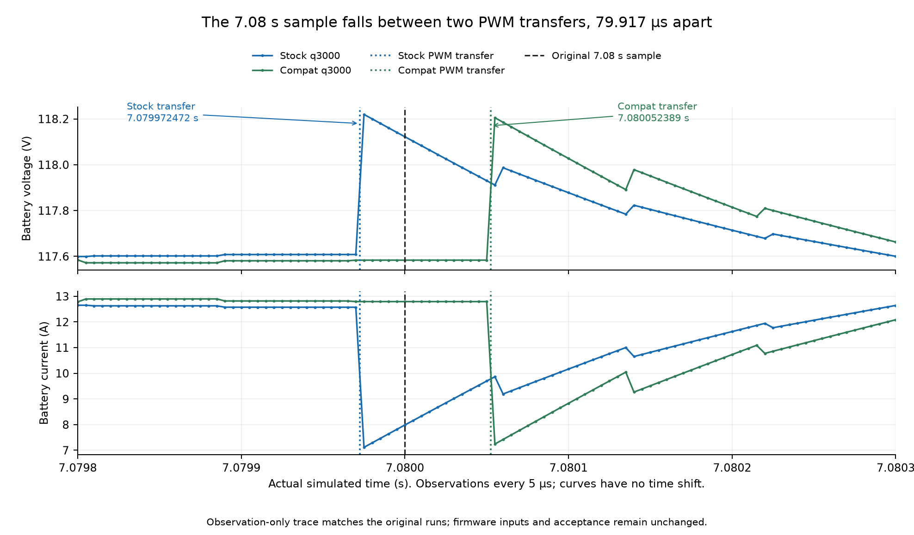

# SOC50 stock/compat investigation

Date: 2026-10-21. Source base: `70a827e`. Investigation branch: `soc50-investigation`.

All six stock/compat cutoffs start with the balance-error detector.
The launch comparison samples opposite sides of similar PWM transients, approximately 80 µs apart.
Full-run equivalence remains open; this study changes no production behavior.
The [follow-up investigation](soc50-high-speed-investigation.md) identifies the Hall transition and tests high-speed command and timing hypotheses.

This study separates the launch voltage comparison from the later cutoff difference.
It uses the accepted [full-effort baseline](full-effort-acceptance.md).
No firmware image, physical parameter, scenario command, tolerance, or comparison window changes for this study.

## Controls and reproduction

The frozen inputs remain in `target/fw-scratch/resume-accepted/`.
All 63 manifest entries and the separate stock firmware digest pass verification.
The scenario uses the generic 80 kg `rigid_ankle_v1` rider at 50% initial SOC.
Sampling stays at 100 Hz, CPI at 2.0, and exception costs at 14/14/8 cycles.
The stock image remains `cbfb328c`; the compat image remains `7fc8a128`.
The [baseline identity table](full-effort-acceptance.md#identity-and-reproduction) gives their complete hashes.

The fresh q3000 comparison matches the accepted JSON in every field except wall time.
The new q3000 recordings also match both accepted scenario reports, except wall time and real-time factor.
The recordings reproduce every original comparison channel's maximum, RMS, and maximum time.
This rules out changed inputs or a stale comparison report as explanations for the failure.

Initial evidence is under `.cache/soc50-investigation/`.
`analysis/input-manifest.json` records the verified inputs.
`analysis/*.command.json` records the capture commands, output hashes, and report checks.
The private evidence archive is `research/timing-proto/soc50-20261021/soc50-evidence.tar.gz` beside the main checkout.
It retains the observer source, trace source, frozen inputs, results, and a per-file SHA-256 manifest.
It excludes build caches and plotting environments.

## Launch voltage difference

The unchanged comparison fails at q3000 with a 0.5384216 V difference at 7.0800000 s.
Its limit remains 0.5 V.
The preceding and following samples have differences of +0.02078 V and -0.00779 V.
Thus, one sampled point exceeds the limit near this peak.
The 100 Hz recordings do not establish the transient's duration between samples.

| Signal at the peak | Stock q3000 | Compat q3000 | Stock minus compat |
|---|---:|---:|---:|
| Battery voltage | 118.122055 V | 117.583633 V | +0.538422 V |
| Battery current | 7.986094 A | 12.793144 A | -4.807050 A |
| Torque current | 82.886826 A | 83.089233 A | -0.202408 A |
| Wheel torque | 71.365562 N·m | 71.539833 N·m | -0.174271 N·m |
| Applied modulation | 38.001270% | 14.965255% | +23.036016 percentage points |
| Ground speed | 3.085808 km/h | 3.086691 km/h | -0.000883 km/h |

The configured pack resistance is `32 × 0.007 / 2 = 0.112 Ω`.
At the peak, `-0.112 × Δbattery_a = +0.5383896 V`.
Only 0.0000320 V remains after this resistance term.
The battery model's instantaneous current term therefore explains the voltage difference at this sample.
This calculation does not identify the cause of the current difference.

Across 6–9 s, the signed mean voltage difference is +0.007327 V and RMS is 0.102764 V.
The original comparison window has RMS 0.059567 V.
These intervals differ; their RMS values must not be interchanged.
Timestamp interpolation retains a 0.538416 V peak.
The approximately 1.9 µs sample-time offset does not explain the failure through this interpolation check.
A 100 Hz trace cannot exclude faster effects between those samples.

The q3000 and q4000 compat captures have identical common sample times and launch signal values.
Stock differs between these quanta.
At 7.08 s, stock q4000 has 117.677017 V, 11.959556 A, and 28.847332% applied modulation.
The difference therefore depends on the stock trajectory in this quantum comparison.
The large voltage-vector difference with little torque difference motivates the finer trace below.

### Startup already differs

Stock q3000 and q4000 first differ at 1.180000014 s, cycle 84,960,001.
The initial signal differences are near float32 precision, while sample times still match.
Battery voltage first differs by one float32 step at 1.23 s.
The largest pre-launch voltage difference is 0.0170364 V at 2.32 s.
The first sample-clock difference occurs later, at 4.25 s, and equals one HCLK cycle.
Thus, the stock states diverge before launch and before sample-clock drift.
This observation does not locate the initial differing firmware instruction or peripheral event.

### The sample falls between two similar PWM transients

A private source copy adds output at existing quantum, MMIO, timer, electrical-step, and snapshot points.
It also reads mapped SRAM directly at existing CCR1 writes.
It adds no peripheral reads, plant synchronization, interrupts, or scenario steps.
The interval is 7.078–7.082 s.
All three complete traces match their original samples, poses, events, and reports, except wall timing.
These runs contain 2,187 stock q3000 samples, 2,056 stock q4000 samples, and 2,171 compat q3000 samples.

Both q3000 snapshots use electrical state at cycle `509760000`, exactly 7.08 s.
The stock current-loop transient reaches PWM before this sample.
The similar compat transient reaches PWM afterward.

| q3000 event | Stock cycle | Compat cycle |
|---|---:|---:|
| First write of the new three-register PWM tuple | 509755642 | 509761520 |
| Apply the complete tuple | 509758018 | 509763772 |
| Electrical state used by the sample | 509760000 | 509760000 |

The PWM application times differ by 5,754 cycles, or 79.9167 µs.
Stock changes CCR1/2/3 from `[1451, 1731, 1269]` to `[966, 2035, 1799]`.
Compat changes them from `[1450, 1733, 1267]` to `[961, 2039, 1801]`.
Each transition transfers all three new values together.
Stock dispatches its update on schedule; compat dispatches one cycle late, approximately 13.9 ns.
Neither a mixed tuple nor material event lateness explains this particular pair of transitions.

This figure retains actual simulated time and applies no alignment shift.
As a separate diagnostic, pairing stock with compat 80 µs later reduces local voltage RMS from 0.219038 V to 0.018047 V.
The interval is 7.0798–7.0803 s.
This diagnostic supports the transient timing explanation; it does not alter acceptance.

The firmware current and voltage values also show similar changes.
These are firmware Q15 values, not physical ampere or volt measurements.

| Firmware value | Stock before → after | Compat before → after |
|---|---:|---:|
| Measured Iq | 7046 → 6142 | 7102 → 6191 |
| Measured Id, after gain | 143 → -3395 | 143 → -3423 |
| Post-circle Vq | 5054 → 8258 | 5102 → 8328 |
| Post-circle Vd | 622 → 9131 | 633 → 9207 |

The failing q3000 sample therefore falls between similar current-loop transients.
It does not establish a persistent 0.538 V battery-model offset.
The [follow-up Hall trace](soc50-high-speed-investigation.md#launch-cause-confirmed) identifies a shared new-sector angle reset as the current-coordinate trigger.
The earlier trajectory phase difference remains open.
These traces do not prove identical trajectories separated by a constant time shift.
The original comparison still fails its unchanged limit.

### A separate q4000 snapshot-age finding

The stock q4000 snapshot reports machine cycle `509760001` but electrical cycle `509756760`.
Its electrical state is 3,241 cycles old, approximately 45.014 µs.
Its reported 28.847332% modulation belongs to that older state.
The timer transfers another complete tuple at cycle `509757001`.
The plant integrates through that transition only after the snapshot.
Thus, this q4000 sample does not provide an equal-time modulation comparison with q3000.
This snapshot-age issue does not explain the q3000 stock/compat failure, whose electrical timestamps match.
Correcting snapshot freshness requires a separate change and fresh baseline validation.

## Observer requirements

The cutoff observer identifies the first executed store that changes `balance_disabled` from zero to one.
An instruction-address watch alone is insufficient.
The CPU reports a watched address before it tests an IT condition.
A watched conditional store can therefore report a hit without a write.

The scratch observer retains the original outer machine quanta and 100 Hz scenario steps.
Within a narrow observation interval, it calls the same CPU backend one instruction at a time.
It checks RAM after each instruction and records the preceding PC when the flag changes.
All CPU exits retain their original behavior.
All six traced runs match their untraced sample streams byte for byte, including raw fields and TIM8 values.
Traced and untraced observer reports match exactly.
Their outcomes, events, and pass/halt status match the frozen baseline.
Simulation durations differ by less than 0.5 ms, the verifier's existing comparison bound.
The observer locates the instruction exactly, but bounds its time within the existing 10 ms sample interval.
It does not obtain an exact instruction timestamp from the public bus interface.

## All six cutoffs start with the error detector

| Firmware | Quantum | First-store interval, s | First store | Firmware pitch | Balance error | Overload count |
|---|---:|---|---|---:|---:|---:|
| Stock | 4000 | 18.5500004–18.5600004 | `0x0800B120` | 36.5959° | 42.1359° | 132 |
| Stock | 3000 | 19.8600001–19.8700001 | `0x0800B120` | 32.4147° | 41.4410° | 511 |
| Stock | 2000 | 18.5500004–18.5600004 | `0x0800B120` | 36.5959° | 42.1359° | 132 |
| Compat | 4000 | 19.7000048–19.7100048 | `0x08007944` | 30.9357° | 41.1206° | 507 |
| Compat | 3000 | 19.7000048–19.7100048 | `0x08007944` | 30.9357° | 41.1206° | 507 |
| Compat | 2000 | 19.7000048–19.7100048 | `0x08007944` | 30.9357° | 41.1206° | 507 |

Every first store belongs to the error detector and has error counter 11.
Each final error-counter sequence advances from 1 through 11 without reset.
The pitch and roll counters are zero.
`tipped`, `fallen`, the hall fault, and the motor hard-cut flag are also zero at that store.
The overload counter remains below its disabling count.
Thus, pitch, roll, overload, and motor hard faults do not initiate these six cutoffs.

Balance error includes firmware pitch, speed tiltback, PWM tiltback, and the 1.2° pedal trim.
At q3000, stock has 6.5996° PWM tiltback and 1.2267° speed tiltback.
Compat has 7.6541° PWM tiltback and 1.3308° speed tiltback.
These offsets explain why error exceeds 40° while firmware pitch remains below 40°.
The measured first-counter-to-store interval is bounded by 10–30 ms.
The observer does not establish a more precise elapsed detector time.

The q3000 motor command is 1050 at each first store, with an Iq reference of 21000 Q15 counts.
Stock measures Iq at 4642 counts; compat measures 4911 counts.
Both retain pre-circle `vq_active = 32000`.
Their post-circle voltage vectors are approximately `(Vq, Vd) = (24847, 20842)` and `(25157, 20151)`.
These values show substantial current-tracking error with constrained output voltage at cutoff.
They do not explain why the trajectories diverge earlier.
Extending the error deadline would change safety behavior without resolving that question.

## Open questions

1. Which startup instruction or peripheral event first separates stock q3000 from q4000?
2. What establishes the trajectory phase difference before the shared Hall transition near 7.08 s?
3. Where does sustained current-tracking error first separate the high-speed stock and compat trajectories?
4. How can snapshots report a consistent electrical timestamp without changing scenario or peripheral scheduling?

`System::now()` uses the current quantum start plus explicit skipped cycles.
It does not add the instruction's position within the quantum to MMIO timestamps.
This is a source-code fact, not an established cause of either SOC50 failure.
Any timing experiment must keep a separate identity and retain the accepted baseline for comparison.
